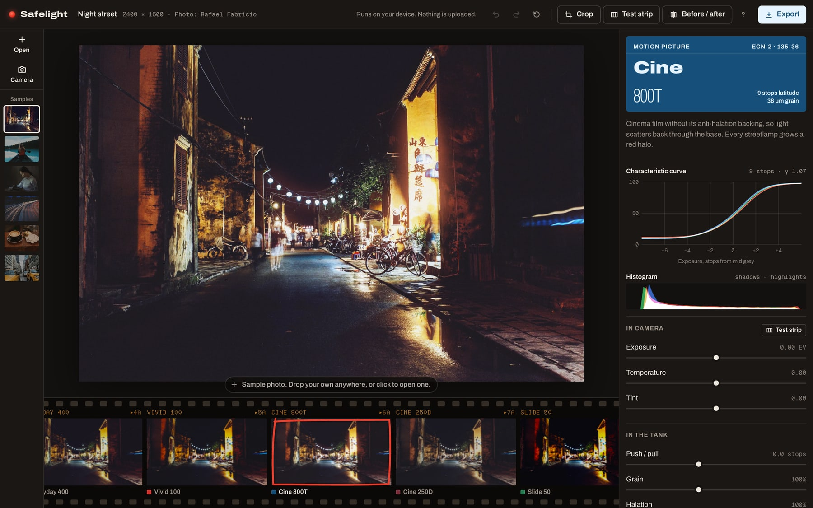
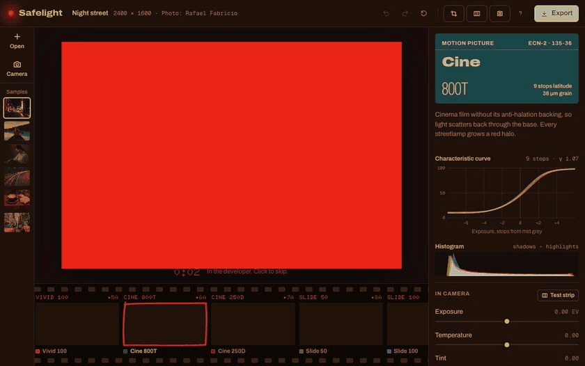
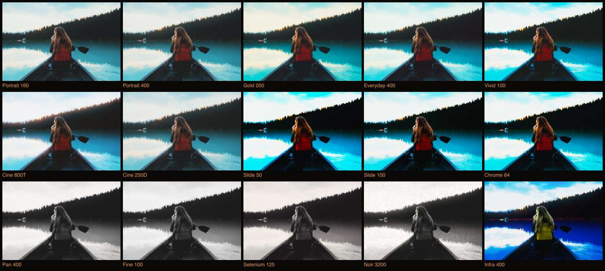
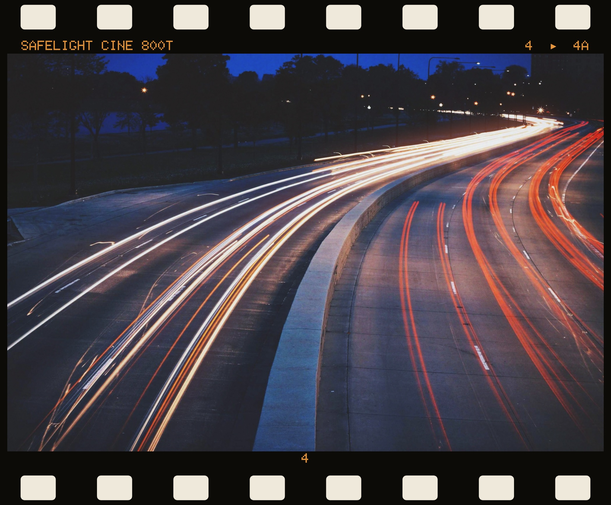
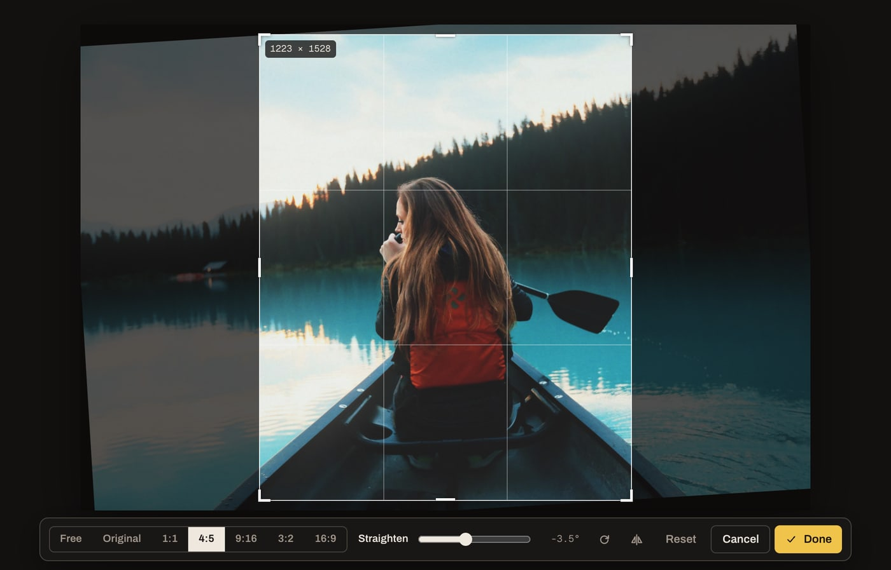
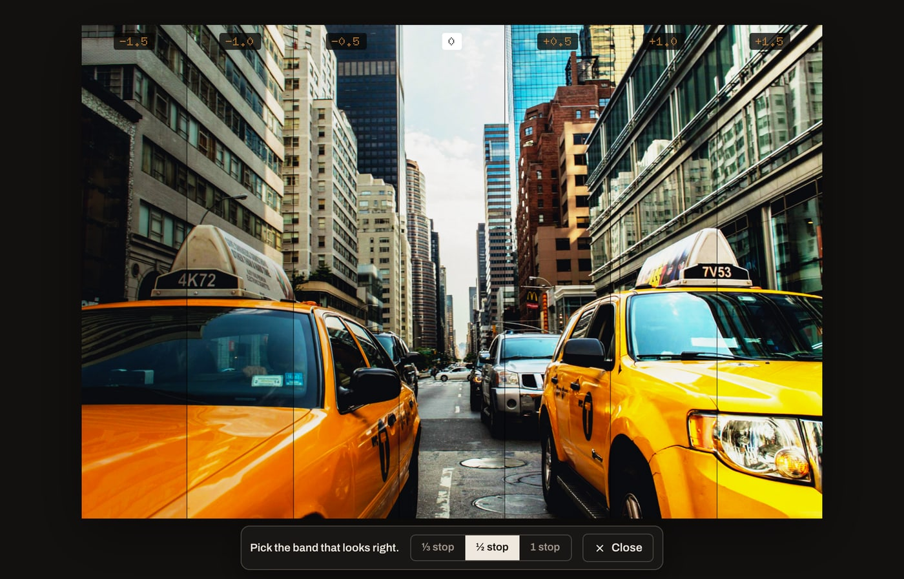

# Safelight

**A real darkroom in your browser.** Drop in a photo and develop it through modelled film stocks. Nothing is uploaded: every pixel is processed on your own graphics card.

**[Try it live](https://selim7417.github.io/safelight/)**



## Why it's different

A filter paints a look over a finished picture. Safelight sends your photo through the steps real film goes through, in the same order. That's why highlights glow, shadows hold their colour and grain sits where it should.



Opening a photo plays the moment that makes a darkroom special. The room goes red and the print emerges in the tray, with the darkest areas first, exactly as on real paper. Then the lights come on and the colour arrives.

## What you can do

- **Develop through 15 film stocks** across colour negative, motion picture, slide, black and white, and false-colour infrared
- **See your own photo on every stock at once** in a film strip, with the keeper marked in red grease pencil
- **Work the way a darkroom works:** exposure and colour in camera, push/pull, grain and halation in the tank, grade and fade on the paper
- **Read the chemistry:** each stock's characteristic curve and latitude update live as you adjust it
- **Shoot through the film, live:** the camera shows the scene on your chosen stock in real time, with grain that changes every frame, and the film strip shows the same scene on the other stocks
- **Shoot a no-peeking roll:** 36 frames with a plain viewfinder and hidden shots, until you develop the whole roll and see what you got
- **Find the right exposure with a test strip:** the picture is divided into bands at stepped exposures, as a printer does on a strip of paper, and you pick the band that looks right
- **Crop, rotate, mirror and straighten:** free or locked to 1:1, 4:5, 9:16, 3:2 or 16:9. Nothing is destroyed, so you can always reopen the crop and change it
- **Compare** with a before/after divider, and double-click to inspect grain at 100%
- **Process a whole roll:** open many photos, copy one look across them, and save them all as a `.zip`
- **Make the print:** export borderless, as a darkroom print with a black keyline, or as a film scan with sprocket holes and edge markings
- **Share a look** with a short recipe code such as `SL1_cine800t_e0.5_g1.4`. Paste it onto any photo
- **Keep your privacy:** no server, no account, no uploads, and location and camera data are removed from exported files
- **Use it anywhere:** it works on phones and keeps working offline after the first visit









## How the film model works

Each step runs in a single fragment shader ([`src/gl/shaders.ts`](src/gl/shaders.ts)), in the order light meets film:

1. **Light reaches the film.** The photo is decoded to linear light, white-balanced and exposed. Clipped camera highlights are expanded back into a scene-like range, so the next steps have real highlights to respond to.
2. **Dye layers see a mix of colours.** A per-stock matrix models the crosstalk between layers, which is where much of a stock's colour character comes from.
3. **Light scatters inside the emulsion.** Highlights bleed back through the film base as halation, which is added *before* development, so it goes through the curve like real exposure. That is why Cine 800T grows red halos.
4. **Development.** Exposure runs through per-channel characteristic curves. Negatives are modelled in two stages, scene to negative and negative to paper, and slides in one. Small differences between the layers' toes and shoulders create the colour shifts in shadows and highlights.
5. **Grain lives in density.** It's applied in the density domain and is strongest in the midtones. Its size is measured against a 35 mm frame, so it looks the same at any resolution.
6. **Paper.** Toning, fade and dithering finish the print.

The curves are generated in TypeScript ([`src/lib/curves.ts`](src/lib/curves.ts)). The **same numbers** feed the shader's lookup table, the on-screen chart and the tests, so the three can't drift apart.

The stocks are original models inspired by the character of classic emulsions. They are not measured from any manufacturer's film, and this project isn't affiliated with any manufacturer.

## Engineering notes

- **Instant adjustments.** The print is one full-screen pass over a mipmapped sRGB texture. Slow steps only re-run when their inputs change: halation and bloom when the exposure or stock changes, the lookup table when the stock, push or paper grade changes.
- **Preview matches export.** Measured on an Apple M1, with grain off, overall brightness for the same recipe stays within about 1.3 levels out of 255 from 300 px to 2400 px wide.
- **Lossless framing.** Crop, rotation and mirror are a single affine transform in the shader, not an edit to the pixels. The geometry is pure TypeScript with its own tests, and the same numbers drive the screen, the thumbnails and the exported file.
- **Live film at full frame rate.** Each camera frame is uploaded to the GPU and developed through the same shader as a still. Measured on an Apple M1 with a simulated 1920 × 1080 camera, at a 1440 × 900 window on a 2× display: a steady 60 fps with no long tasks, with the film strip and histogram updating live.
- **The camera stays off until you ask.** It only starts when you click Camera, and closing it stops every track, which turns the device's camera light off. A shot stores the untouched frame, so the film can still be changed afterwards.
- **Large photos.** Full-size bitmaps stay out of React state and only three stay decoded at once. Photos over the GPU's texture limit are scaled to fit, and export buffers are freed straight away. A 6000 × 4000 test image exported in about 3 seconds.
- **Fast first visit.** The roll uses tiny thumbnails and the first print develops from a light preview, while the full photo downloads behind it and swaps in without interrupting anything. That cuts sample images before the first picture from about 2.1 MB to about 145 KB. On a simulated 1 Mbit/s connection, with an uncompressed test server, the first print starts in about 4.5 seconds.
- **Small bundle.** About 93 KB of gzipped JavaScript, with no 3D or image-processing library: the WebGL2 pipeline is hand-written.
- **Accessible.** Sliders are real range inputs, every control has a name, everything has a keyboard path, and reduced-motion settings skip the reveal.

## Run it

```bash
npm install
```

```bash
npm run dev
```

## Test it

```bash
npm test
```

```bash
npx playwright install chromium
```

```bash
npm run test:e2e
```

- **136 unit tests** cover every stock's curve (it never darkens as exposure rises, and it hits its mid-grey target), film behaviour (pushing builds contrast and costs latitude, negatives out-range slides), crop and rotation geometry, recipe codes, the ZIP writer and print layouts.
- **103 end-to-end checks** run the production build with real mouse drags and real downloads, including whole-roll ZIP export, phone layout, offline use and a check that no request ever leaves the app's own origin. Crops and rotations are verified by reading the exported pixels, the test strip by measuring each band's brightness, and the camera with Chromium's simulated video device, including blocked and missing cameras and a full 36-frame roll.

## Deploy it

`npm run build` writes a fully static site to `dist/`, with relative paths, so it runs from any host or subfolder: GitHub Pages, Netlify, Vercel or Cloudflare Pages.

The live site is on GitHub Pages. After committing a change, this publishes it to the `gh-pages` branch:

```bash
npm run deploy
```

If you replace the sample photos, regenerate their light copies with `npm run samples`.

## Known limits

- Browsers can't read camera RAW files. HEIC opens only where the browser supports it, mainly Safari. Everything else needs converting to JPEG or PNG first.
- The camera needs a secure (https) page or localhost, and some embedded previews block it entirely.
- The camera has only been tested against Chromium's simulated device, not on physical webcams or phones.
- Colour management is sRGB throughout.

## Credits

Sample photographs are from [Unsplash](https://unsplash.com/license), under the Unsplash License:
[Rafael Fabricio](https://unsplash.com/photos/nKRVmvjW3rE) (night street),
[Roberto Nickson](https://unsplash.com/photos/7BjmDICVloE) (lake),
[hieu le](https://unsplash.com/photos/SrkuyPb3aUk) (reader),
[Caleb George](https://unsplash.com/photos/URmkfvtK3Qw) (light trails),
[Carli Jean](https://unsplash.com/photos/UWRqlJcDCXA) (café),
[Andrew Ruiz](https://unsplash.com/photos/bI2j1olMXUA) (taxis).

Typefaces: [Archivo](https://fonts.google.com/specimen/Archivo), [Doto](https://fonts.google.com/specimen/Doto) and [Geist Mono](https://vercel.com/font), under the SIL Open Font License.
